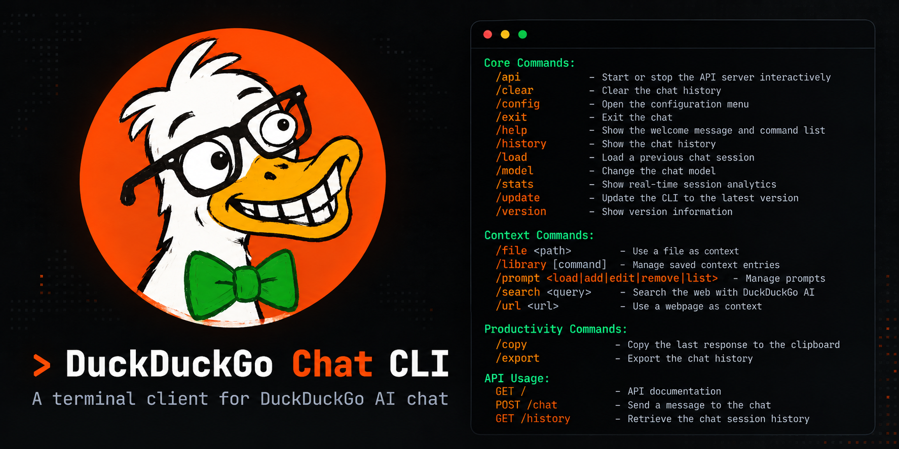
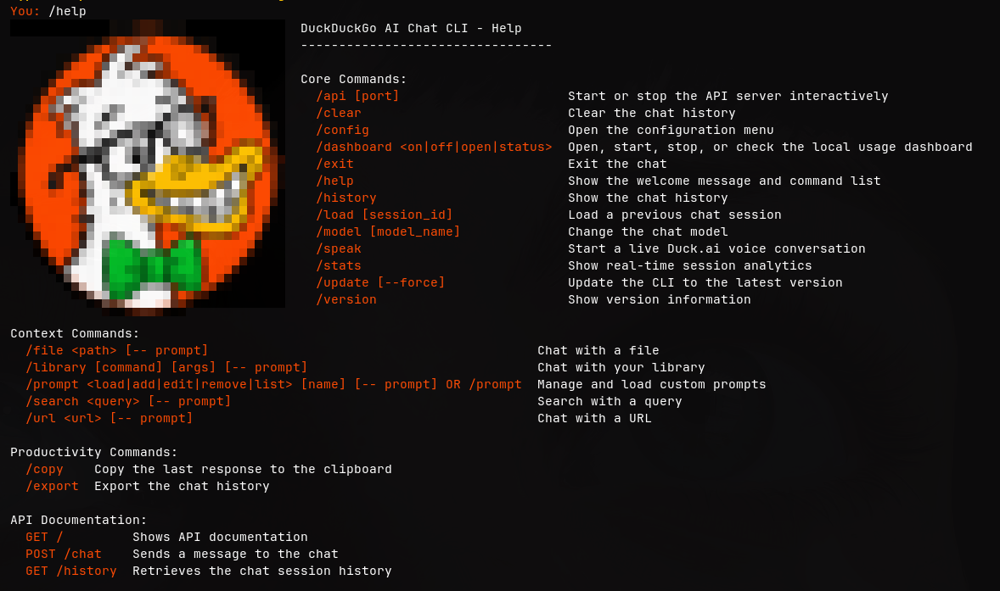
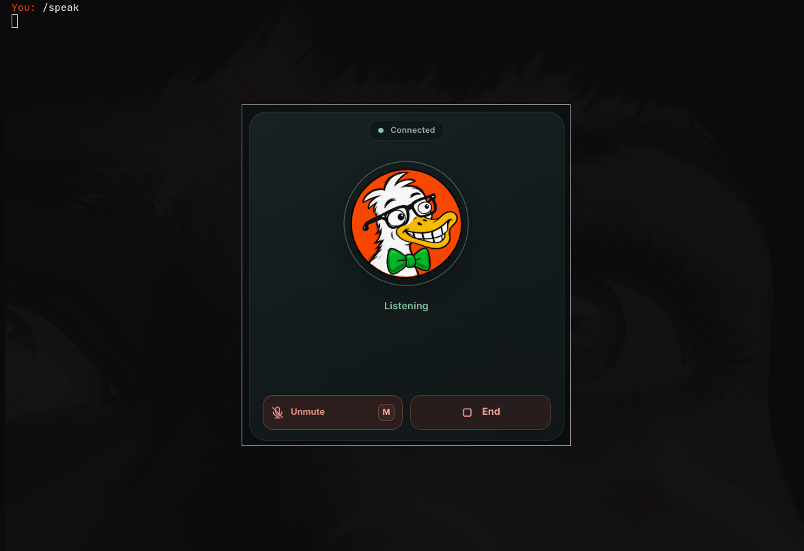
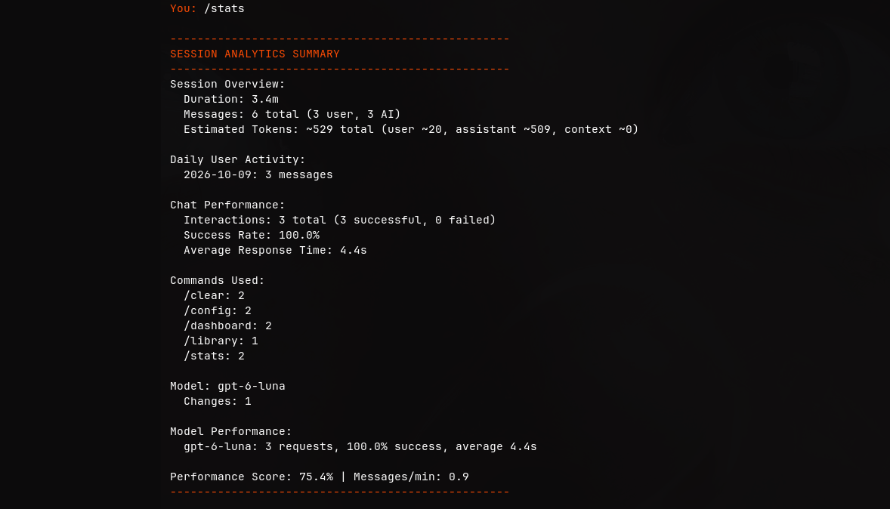
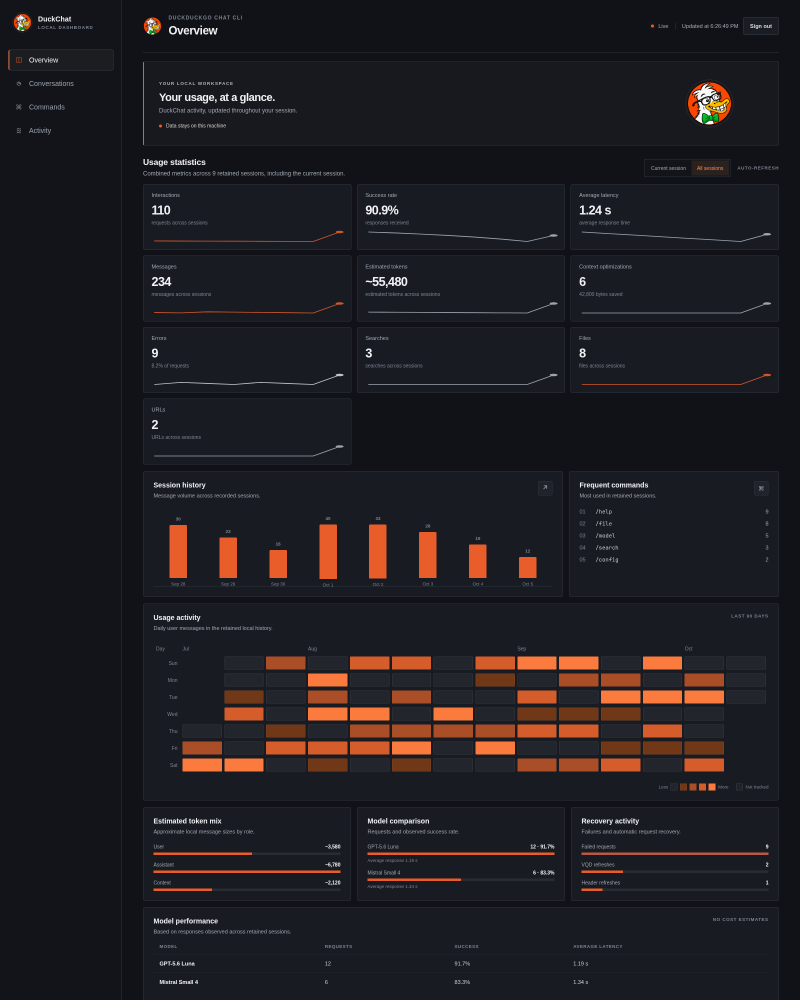
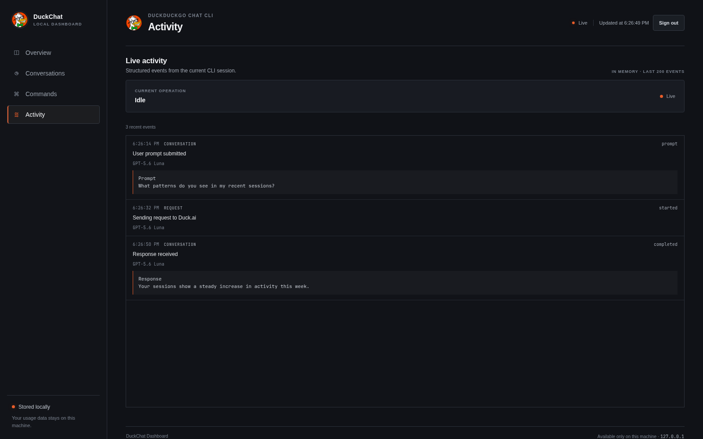
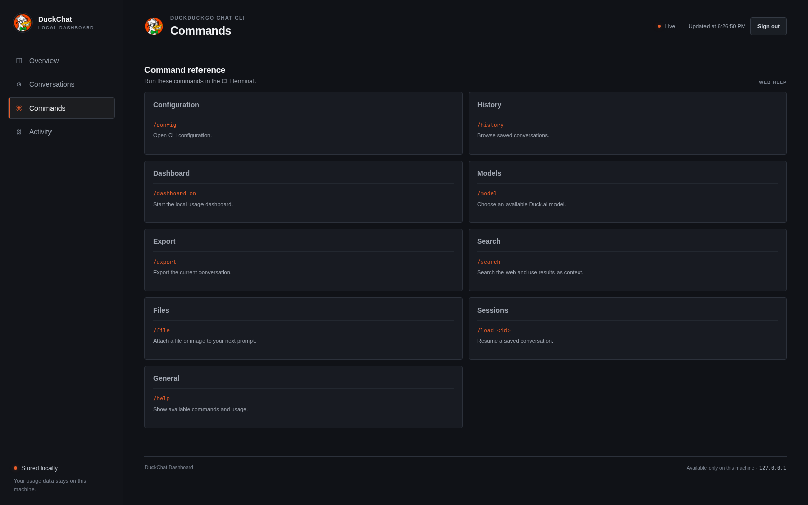
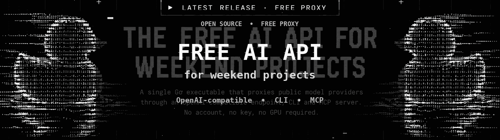

# DuckDuckGo AI Chat CLI

<div align="center">
  
  <br>
  <strong>A terminal client for Duck.ai</strong><br>
  <em>Switch models, bring in context from files, web search and URLs, and keep your conversations close at hand.</em>
</div>

<p align="center">
  
  <a href="https://github.com/benoitpetit/duckduckgo-chat-cli/releases/latest">
    
  </a>
  
  <a href="https://liberapay.com/devbyben">
    
  </a>
</p>

<p align="center">
  <a href="#key-features">Features</a> •
  <a href="#screenshots">Screenshots</a> •
  <a href="#installation">Install</a> •
  <a href="#usage">Usage</a> •
  <a href="#available-models">Models</a> •
  <a href="#configuration">Configuration</a> •
  <a href="#local-usage-dashboard">Dashboard</a>
</p>

## Key features

- Stream model replies in the terminal with readable Markdown, code formatting, and configurable response frames.
- Choose from Duck.ai models and add context from local files, web searches, URLs, or searchable file libraries.
- Coordinate two or three Duck.ai models with live stage progress, resumable failures, an explicitly partial answer option, and a compact result summary.
- Generate images with a direct prompt or a guided flow, and start live voice conversations from the CLI.
- Save, search, and restore conversations; reuse saved prompts and review session statistics.
- Pick from five color themes, use command suggestions, and keep DuckChat available in the system tray with shortcuts for text and voice chat.
- Open the optional local dashboard to review usage, recent activity, and model statistics. A local HTTP API is also available for integrations.

## Screenshots

### Terminal

| Interactive help                                                                                                                         | Voice conversation                                                                                                                             | Session statistics                                                                                                                  |
| :--------------------------------------------------------------------------------------------------------------------------------------- | :--------------------------------------------------------------------------------------------------------------------------------------------- | :---------------------------------------------------------------------------------------------------------------------------------- |
| <a href="docs/images/cli-help.png"></a> | <a href="docs/images/voice-session.png"></a> | <a href="docs/images/session-stats.png"></a> |
| The `/help` command list.                                                                                                                | A live voice session with controls and subtitles.                                                                                              | Session duration, usage, and model statistics.                                                                                      |

### Local dashboard

The dashboard screenshots use representative sample metrics.

| Overview                                                                                                                                      | Activity                                                                                                                                   | Command reference                                                                                                                                      |
| :-------------------------------------------------------------------------------------------------------------------------------------------- | :----------------------------------------------------------------------------------------------------------------------------------------- | :----------------------------------------------------------------------------------------------------------------------------------------------------- |
| <a href="docs/images/dashboard-overview.png"></a> | <a href="docs/images/dashboard-activity.png"></a> | <a href="docs/images/dashboard-commands.png"></a> |
| Usage charts and model statistics.                                                                                                            | Recent CLI activity.                                                                                                                       | The dashboard's command reference.                                                                                                                     |

## Installation

> **[Download the latest release](https://github.com/benoitpetit/duckduckgo-chat-cli/releases/latest)** for Linux, Windows, or macOS.

Release builds include AMD64 and ARM64 binaries for Linux and Windows, and AMD64 and ARM64 binaries for macOS. Download the asset matching your operating system and processor, then run it from a terminal. Chrome or Chromium is required for Duck.ai chat and voice; version 115.0.5790.110 or later is recommended. No browser extension or DuckDuckGo account is required.

To build from source, see the [build and release guide](docs/BUILD.md).

## Usage

Run `duckchat` with no arguments to open the interactive mode. Accept Duck.ai's terms on first use, then enter messages or slash commands at the `You:` prompt. Use `/help` inside the chat for the complete command list. `duckchat --help` describes launch options and highlights common chat commands.

The examples below use `duckchat` as the executable name. If you keep the release asset's original filename, use that filename in its place.

### Command-line options (when launching)

These flags are passed to `duckchat` when you launch it from the terminal. Use `--help` or `--version` without opening an interactive chat. Send a single prompt with `--prompt`; choose a model with `--model`, or use `--json` for machine-readable output. Pass `-` to read a prompt from standard input. Add repeatable `--file`, `--url`, and `--search` options to give that prompt context:

```sh
duckchat --help
duckchat --prompt "Explain the Go memory model" --model gpt-6-luna
duckchat --prompt "Summarize this input" --json
printf 'Summarize this input' | duckchat --prompt -
duckchat --prompt "Compare these sources" --file report.pdf --file chart.png --url https://example.com --search "latest release notes"
```


The first interactive run must accept Duck.ai's terms before one-shot prompts can run without a terminal. Context flags require `--prompt`; `--prompt -` can read the question from standard input. Context is prepared in a stable order: all files, then URLs, then searches. `--file` accepts supported text files, PDFs, and PNG/JPEG/WebP images. Text context is limited to 2 MiB combined; image files keep their existing 10 MiB per-file limit. One-shot mode writes the answer to standard output and status or error messages to standard error. JSON mode writes one response or error object. It does not start the tray service, dashboard, API, or startup update check.

### Diagnostics

Run `duckchat doctor` to check local configuration, terms acceptance, browser availability and the export directory. It performs local checks without opening an interactive chat. Network checks are off by default.

Use `duckchat doctor --network` to check Duck.ai reachability and browser capture. This check has a timeout and does not submit a prompt or create a conversation. Use `duckchat doctor --json` for a stable machine-readable report with check IDs, statuses and an exit code. Reports omit captured request data and credentials.

```sh
duckchat doctor
duckchat doctor --network
duckchat doctor --json
```

### Command reference (interactive chat)

Start the interactive chat with no arguments:

```sh
duckchat
You: /help
```

These slash commands are typed at the `You:` prompt after the interactive chat starts. They are different from the launch options above. Type `/help` in the chat to show the full list.


#### Chat and settings

| Command               | Description                                               |
| --------------------- | --------------------------------------------------------- |
| `/help`               | Show the command list                                     |
| `/model [model_name]` | Choose or change the model                                |
| `/config`             | Change the model, appearance, shortcuts, and app settings |
| `/clear`              | Start a fresh chat and Duck.ai session                    |
| `/stats`              | View current session statistics                           |
| `/history`            | Browse saved conversations                                |
| `/sessions [query]`   | Search, organize, restore, and remove saved sessions       |
| `/load [session_id]`  | Restore a saved conversation                              |
| `/speak`              | Start or restore a voice conversation                     |
| `/image [idea]`       | Generate an image, with an optional guided prompt flow    |
| `/coordinate [cancel|runs|show <run_id>]` | Coordinate models and browse saved reports |

#### Add context and manage prompts

| Command                                 | Description                                       |
| --------------------------------------- | ------------------------------------------------- |
| `/search <query> [-- prompt]`           | Search the web and use results as chat context    |
| `/file <path> [-- prompt]`              | Add a file to chat or ask about it directly       |
| `/url <url> [-- prompt]`                | Add a web page to chat or ask about it directly   |
| `/library [command] [args] [-- prompt]` | Manage local file libraries and use their content |
| `/context`                              | Show retained sources, approximate sizes, and optimization state |
| `/sources`                              | Show source references supplied with the latest exchange |
| `/prompt [command]`                     | Add, edit, list, load, or remove saved prompts    |

#### Export and services

| Command                              | Description                                        |
| ------------------------------------ | -------------------------------------------------- |
| `/copy`                              | Copy the last response or a code block             |
| `/export`                            | Export conversation content                        |
| `/issue`                             | Fill in a report and open a prefilled GitHub issue |
| `/dashboard <on\|off\|open\|status>` | Start, stop, open, or check the local dashboard    |
| `/api [port]`                        | Start or stop the local HTTP API                   |
| `/update [--force]`                  | Check for or install an update                     |
| `/version`                           | Show version information                           |
| `/exit`                              | Close the interactive chat                         |

Use `&&` to combine `/file`, `/url`, and `/search` before a prompt. `/library`, `/prompt`, `/image`, `/coordinate`, and `/speak` are standalone commands. `/context` and `/sources` show source references retained for chat; byte-to-token counts are rough estimates using about four bytes per token. Numbered source labels are sent to Duck.ai only when source metadata exists. Default panels and labels show short file names rather than local paths; a Markdown conversation export includes each source URI so exported references remain useful. The [user guide](docs/USAGE.md) has examples and more detail about each command.

`/file` and `/library` also accept text-based PDFs. Extracted text retains `[Page N]` markers; PDF input and extracted text are each limited to 10 MiB, and library imports also keep the existing 2 MiB aggregate context limit. Scanned PDFs without embedded text are not OCR'd, and password-protected PDFs are unsupported.

Run `/coordinate` to choose two or three Duck.ai models, edit their roles, and select a chain, independent-answer, or debate flow for your next question. Each strategy starts with two prefilled agents and role suggestions suited to its workflow. Model and role choices are saved separately for Independent, Chain, and Debate, so switching strategies restores that strategy’s preset. The menu shows planned requests (retries excluded) and maximum concurrency. Independent and Debate can run independent steps in parallel. Model, role, and strategy edits are saved locally as you make them. On failure, resume incomplete stages, request a clearly marked partial synthesis when outputs are missing, or stop without changing conversation history. A result panel lists the models, roles, completed stages, and whether synthesis used all planned outputs. After an accepted answer, choose whether to save that run’s prompts and intermediate outputs; **Do not save** is the default. Saved reports stay in the compressed local conversation archive, follow its retention and deletion rules, and remain outside normal chat history and analytics. Use `/coordinate runs` to list reports and `/coordinate show <run_id>` to inspect one in the active conversation. These reports preserve model outputs; they do not verify their claims. Use `/coordinate cancel` to clear a pending selection. See the [coordinate guide](docs/USAGE.md#coordinate-models-for-one-question) for details.

### Example

Gather context from a web page, a search, and a local file before asking a question:

```text
/url https://go.dev/doc/ && /search Go concurrency && /file notes.md -- Compare these sources and summarize the key points.
```

The normal interactive launch can also stay in the system tray after the terminal closes. Use the tray menu to open a text chat, restore voice chat, configure shortcuts, or quit the background service. Default shortcuts are `Ctrl+Alt+T` for text and `Ctrl+Alt+V` for voice. Change them in `/config` or from the tray menu.

## Available models

Choose a model with `/model`, or pass its ID with `--model` in one-shot mode. Duck.ai controls model availability and names, which can change.

| Model            | ID                     |
| ---------------- | ---------------------- |
| GPT-6 Luna       | `gpt-6-luna`           |
| GPT-5.6 Luna     | `gpt-5.6-luna`         |
| GPT-5.4 Nano     | `gpt-5.4-nano`         |
| GPT-5.4 Mini     | `gpt-5.4-mini`         |
| Claude Haiku 4.5 | `claude-haiku-4-5`     |
| Mistral Small 4  | `mistral-small-2603`   |
| GPT OSS 120B     | `tinfoil/gpt-oss-120b` |
| Gemma 4 31B      | `tinfoil/gemma4-31b`   |

## Configuration

Open `/config` to choose a default model, color theme, response frame, export folder, global prompt, search behavior, library folders, voice window size, and other options. Changes are saved as you make them. Themes include `official`, `retro`, `mono`, `dracula`, and `nord`. **Reset all settings to defaults** restores the full configuration after a default-No confirmation and typing `RESET`. It clears saved credentials and custom prompts/profiles, stops active API and dashboard services, and reapplies the default 90-day history retention; older history entries may be removed. Exported files are not deleted, and terms must be accepted again on the next launch.

Duck.ai's native web search and image generation can be enabled under **Duck.ai Native Tools**. `/search` remains a separate command that explicitly searches the web and adds results to the conversation. The `/image` command temporarily enables image generation for that request.

## Local usage dashboard

The optional dashboard listens on `127.0.0.1` and shows local usage, recent CLI activity, and conversation history when enabled. Its conversation page can search, rename, tag, favorite, and delete saved sessions; delete asks for confirmation. Start or open it with `/dashboard on` or `/dashboard open`; use `/dashboard status` to check it and `/dashboard off` to stop it. Conversation controls appear only when **Show Conversations** is enabled. Dashboard privacy, retention, and password settings are available in `/config`.

When enabled, the optional HTTP API binds to the local machine by default. Enable it in `/config`, then use `/api` to start or stop it. `POST /api/v1/chat` returns a complete JSON response; `POST /api/v1/chat/stream` returns server-sent events for incremental clients. See the [API reference](docs/README.md) for the specification and event format.

## Privacy and support

Conversation history and usage data are stored on your device. The dashboard hides conversation text by default, and voice audio and transcripts are not saved in text chat history. Conversation analysis is opt-in. More details are in the [user guide](docs/USAGE.md#local-data-and-privacy).

DuckDuckGo AI Chat CLI is an unofficial client and is not affiliated with or endorsed by DuckDuckGo. Follow DuckDuckGo's terms and check important answers against reliable sources.

For source builds and release workflows, see the [build and release guide](docs/BUILD.md). The [user guide](docs/USAGE.md) covers detailed command usage, privacy, and troubleshooting.

<p align="center">
  <a href="https://devbyben.fr/don">Support the project</a>
</p>

## Discover Voie

<p align="center">
  <a href="https://github.com/benoitpetit/voie">
    
  </a>
</p>
